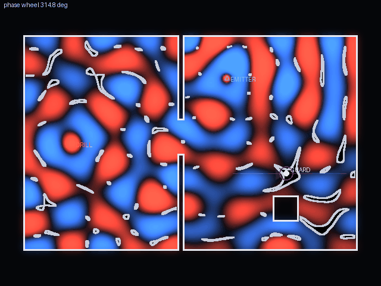

# Antiphase

*A heist where you hide by adding sound.*

Every noise in the building is a real wave, solved live. Your safe drill screams, and
the guard in the next gallery hears it. So you mount a second speaker and roll a phase
wheel until a band of real, physically honest silence slides across the floor and sits on
his head. He keeps walking. You keep the band on him. You hear exactly what he hears go
quiet.

**Status:** design. No game code yet. Built for [Hack Club Terra](https://terra.hackclub.com/),
Oct 19 2026 – Jan 10 2027.

## Read first

- [docs/00-concept.md](docs/00-concept.md): the idea, the verb, a minute of play, the level ladder, what is cut, the kill test.
- [docs/01-inspiration.md](docs/01-inspiration.md): the look, palette, references and the code-rendered studies.
- [DECISIONS.md](DECISIONS.md): why things are the way they are (append-only).
- [STATE.md](STATE.md): where the project is right now and the next action.

## Provenance

The design grew out of a game-ideation session on 2026-09-23 and was adopted for Terra on
2026-10-07. Ryan writes the game code. Claude drafts design docs, reviews, and wrote the
mood-board render script in `docs/inspiration/`, which is labelled as such and is not game
code.
