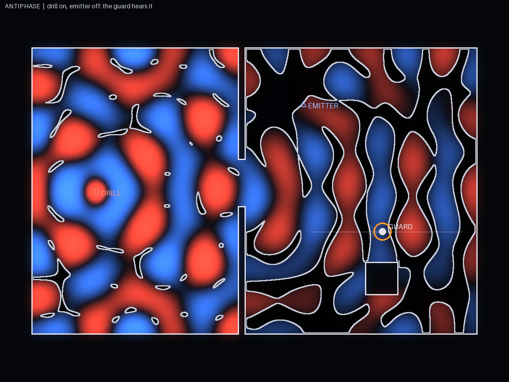
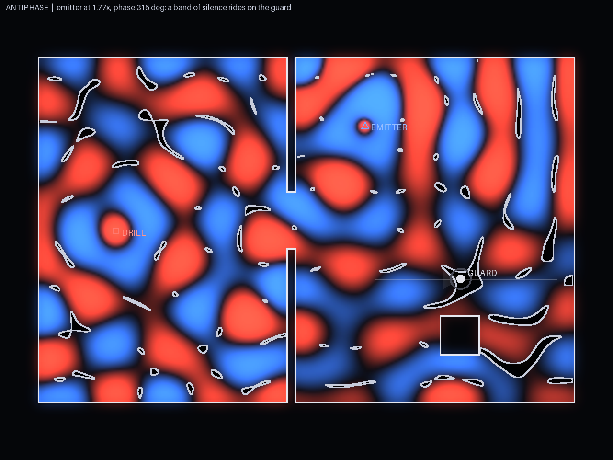

# 01 · Inspiration and look

**In one line:** a physics-class ripple tank that someone is sneaking through.

Near-black. Thin white line art for walls, like an architect's cutaway. The sound field
itself is the only colour on screen: red for positive pressure, blue for negative, with
soft bloom. Silence is true black with a thin pale contour. Nothing is textured, nothing
is drawn by hand; every shape on screen is computed.

## Code-rendered studies

These three images come from `render_fringes.py` in this folder: a 320×240-cell wave
simulation of two galleries joined by a 3 m doorway, a steady drill tone at λ = 4 m, and
one emitter tuned so the two tones cancel at the guard's ear. The script is Claude's
mood-board tool, not game code. Regenerate with:

```bash
uv run --no-project --with numpy --with pillow python docs/inspiration/render_fringes.py
```

| | |
|---|---|
|  |  |
| **Before.** Only the drill runs. Its field diffracts through the doorway into the guard's gallery and settles into standing fringes. Where the drill alone is under the guard's threshold the floor is black. The guard stands in a loud spot; his ring is orange. | **After.** The emitter is tuned (1.77× the drill's source strength, phase 315°). The null lands on the guard; his ring goes dark. Note that the rest of the gallery got *louder*: the emitter floods it, and only a thin curve stays silent. |


**Phase sweep.** One full turn of the phase wheel. The band of silence slides along the
patrol line and the ring lights up the moment it leaves the guard.

### What the render measured (2026-10-07, crude, one configuration)

| Quantity | Value |
|---|---|
| Sim | 320×240 cells at 0.1 m, c = 34.3 m/s, 693 steps/s, λ = 4 m (8.57 Hz in the sim) |
| Drill level over the guard's threshold | 4.5 dB |
| Emitter needed for an exact null at the guard | 1.77× drill source strength, phase 315° |
| Silence band at the guard | 1.4 m along the patrol, 1.4 m across |
| Free-field estimate it was checked against | 0.16 λ = 0.64 m |
| Patrol under threshold at that one setting | 15 % of 9.6 m |
| Band centre reachable by turning the wheel | x = 24.0 → 29.0 m (5 m of the 9.6 m patrol) |
| East gallery under threshold | 37 % with the drill alone → 5 % with the emitter on |

Against the kill-test numbers in [00-concept.md §9](00-concept.md) (band ≥ 0.5 m, reach
≥ 4 m of patrol): this configuration **passes on width and reach**. It has **not**
measured how steady the band is over time, the lag after a wheel move, or any λ or
damping other than this one. Those are the kill test proper.

### What it taught

1. **Reflections help.** The band is about twice the free-field estimate. Room modes
   plus a "below threshold, not zero" rule give a body-width target, which is what the
   design hoped for and could not assume.
2. **The emitter floods the room.** Because the drill is far from the guard and goes
   through a doorway, matching it at the guard's ear takes an emitter louder than the
   drill's own field everywhere nearby. Silence went from 37 % of the gallery to 5 %.
   This is a design lever, not a bug: a second guard elsewhere would now hear *more*. It
   also argues for mount points at roughly the same distance from the guard as the drill.
3. **Phase alone reaches half the patrol.** The wheel moved the band over 5 of 9.6 m,
   only on the guard's far side. Reaching the near side needs a different gain or mount,
   which is why the plan has gain steps and discrete mounts, and why they are the
   *planning* layer while phase is the *live* control.

## Palette and type

| Token | Value | Use |
|---|---|---|
| `--bg` | `#0A0B10` | the void |
| `--line` | `#E6E8F0` | walls, figures, HUD lines |
| `--press-pos` | `#FF4A3C` | positive pressure |
| `--press-neg` | `#3C7CFF` | negative pressure |
| `--silence` | `#000000` | under the guard's threshold |
| `--contour` | `#C8CDDC` | edge of silence |
| `--ghost` | `#8A90A8`, dashed | where the band will settle |
| `--ear` | `#FF9628` | guard's ear ring as it fills |

Type: one monospace face for everything (IBM Plex Mono or similar), small, never bold.
The HUD should read like an instrument, not a game menu.

## References

Looked at, not copied. None of these images belong in the repo.

- **Falstad Ripple Tank** ([falstad.com/ripple](https://www.falstad.com/ripple/)): the
  canonical two-source interference look; also the thing the game must *not* be mistaken
  for. The guard, the line art and the black band are what separate us from it.
- **Ripple tank photographs** ([Wikipedia](https://en.wikipedia.org/wiki/Ripple_tank)):
  the real-world fringes, and the grey lines of destructive interference.
- **Chladni figures** ([Wikipedia](https://en.wikipedia.org/wiki/Ernst_Chladni)): nodal
  lines as art. Our silence contour is a Chladni line you can stand on.
- **Active noise control** ([Wikipedia](https://en.wikipedia.org/wiki/Active_noise_control)):
  the real mechanism, and the reason it only works in a small zone around the ear. Our
  whole game is that footnote.
- **Dark Echo** (2015, [review](https://www.pocketgamer.com/dark-echo/review/)): black
  screen, white sound lines, nothing else. The discipline of showing only what matters.
- **Mark of the Ninja** (2012, [sound design write-up](https://designingsound.org/2013/06/the-dynamics-of-mark-of-the-ninja)):
  sound rings as HUD. The clearest prior art for *visible sound in stealth*, and the thing
  our verb inverts.
- **Thief** (1998) light gem and **Splinter Cell: Chaos Theory** (2005) noise meter: one
  instrument that tells you exactly how exposed you are. Our ear ring descends from these.
- **Opus Magnum** (2017): hand-built puzzles, many solutions, scored against a par, shared
  as GIFs. The model for our placement layer and for the caught-replay.
- **Architectural cutaways** (Stephen Biesty's cross-section books): floors peeled open,
  everything legible at once. The reference for the week-9 cutaway camera.

## Anti-references

Things this should never look like: neon synthwave grids, chunky pixel art, photoreal
museum renders, a sci-fi HUD with brackets and scan lines, anything with a texture.
If it would look fine as a screenshot of a different indie stealth game, it's wrong.
